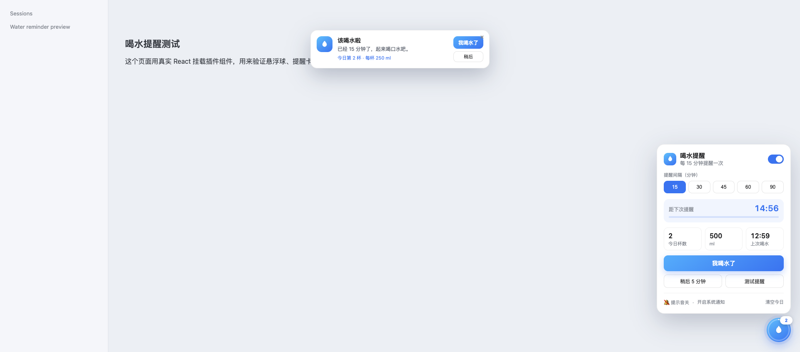

# 喝水提醒 · dsh-water-reminder

一个给 DeepSeek Harness Web GUI 用的喝水提醒插件：右下角常驻一颗水位悬浮球，按设定的间隔提醒你喝水。



## 功能

- **间隔提醒**：15 / 30 / 45 / 60 / 90 分钟可选，默认 45 分钟。
- **双重提醒**：页面内卡片提醒 + 系统通知（macOS / Windows 的通知中心），附一声轻提示音。
- **喝水记录**：点「我喝水了」记一杯（250 ml），显示今日杯数、饮水量和上次喝水时间。
- **稍后再说**：支持推迟 5 分钟，不会堆积多条提醒。
- **暂停 / 继续**：开关随时暂停，暂停期间不提醒。
- **进度可见**：悬浮球外圈显示距下次提醒的进度，右上角角标显示今日杯数。
- **状态持久化**：设置与今日记录写入 localStorage + cookie，刷新页面或改端口后仍然保留。
- **主题适配**：使用 DSH 的 `--dsw-alias-*` 设计变量，自动跟随明暗主题。
- **中英双语**：按浏览器语言自动切换。

## 目录结构

```
dsh-water-reminder/
├── package.json        # dsh.bundle + dsh.client 声明
├── cordis.patch.yml    # Bundle 补丁：插入 ui-water-reminder 行
├── lib/
│   ├── index.js        # Host 端空插件，让 Loader 能发现这个包
│   └── client.js       # 浏览器端插件（悬浮球 + 提醒卡片）
├── market/index.json   # 插件市场索引（format 1）
├── icon.svg            # 市场图标
├── preview.png         # 面板预览
└── README.md
```

## 从插件市场安装

1. 在 **Plugins** 页面打开 **Experimental plugins**，启用 **Custom plugin indexes**。
2. 切到 **Discover**，点 **Add index source**，填入：

   ```
   https://raw.githubusercontent.com/zeng5630/dsh-water-reminder/main/market/index.json
   ```

3. 搜索「喝水提醒 / Water Reminder」，点 **Install**。
4. 安装完成后按提示重启一次 DeepSeek Harness。

## 手动安装到 desktop profile（开发用）

在插件目录的上级执行（本机路径按实际修改）：

```bash
dsh plugin --profile desktop add link:/Users/zengyanjun/Documents/deepseek-harness/default-workspace/dsh-water-reminder
```

然后在 `~/.dsh/profiles/desktop/cordis.patch.yml` 末尾追加一行配置：

```yaml
- id: ui-water-reminder
  name: dsh-water-reminder
```

保存后需要**重启一次 DeepSeek Harness**。新安装的包在宿主启动时才会建立模块映射；HMR 只会热更新已经加载过的插件和配置，无法把运行中的新包挂进当前会话。重启后右下角会出现水滴球。

也可以不写上面的 patch 行，改为把 `dsh-water-reminder` 加入 `package.json` 的 `dsh.profile.bundles`；本包已声明 `dsh.bundle.patch`，Bundle 层会自动插入同一行。

卸载：

```bash
dsh plugin --profile desktop remove dsh-water-reminder
```

并从 `cordis.patch.yml` 移除对应条目。

## 使用

1. 点右下角的水滴球展开面板。
2. 选择提醒间隔，保持开关为开启状态。
3. 首次开启时浏览器会询问通知权限，允许后即可收到系统通知。
4. 到时间后，顶部会出现提醒卡片，可点「我喝水了」或「稍后」。
5. 面板底部可以关闭提示音、开启系统通知或清空今日记录。

## 说明

- 提醒计时以页面打开为前提；桌面应用窗口最小化时仍会继续计时并弹出系统通知。
- 系统通知需要用户授权；被拒绝时页面内提醒仍然有效。
- 数据只保存在本机浏览器中，不上传。
